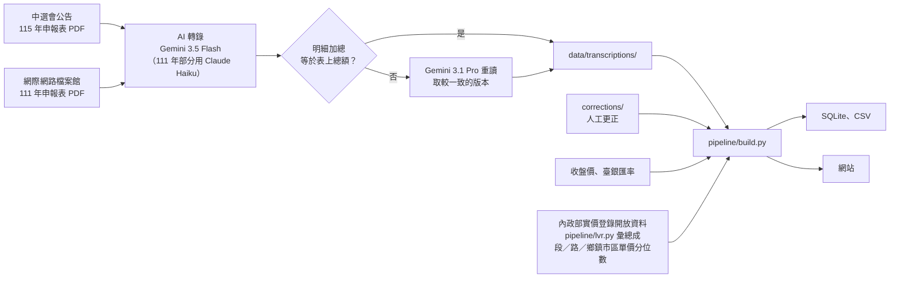
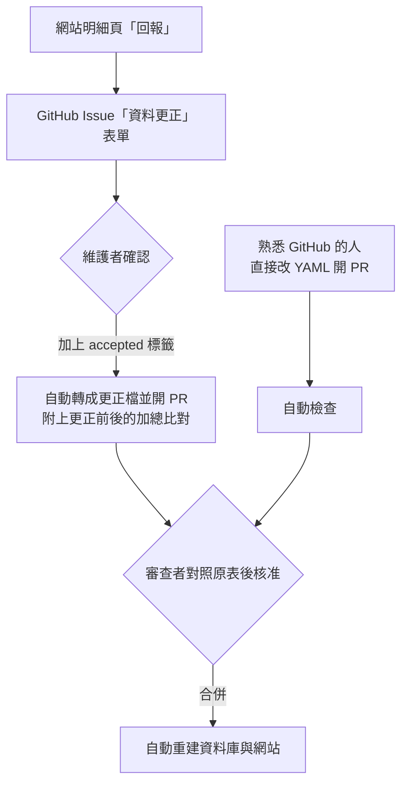

# 候選人財產透視

115 年地方公職人員選舉 1,590 位候選人的財產申報表，逐筆轉成資料庫，並和其中 871 位在 111 年的申報比較。

- **網站**：https://sigma-snaken.github.io/candidate-wealth-tw/ ，可依選區、政黨查詢，並排比較候選人
- **資料庫下載**：網站上的「下載資料庫」，或 `download/candidate_wealth.sqlite`、`download/csv/*.csv`
- **原始申報表 PDF**：[Releases](https://github.com/Sigma-Snaken/candidate-wealth-tw/releases) 的 `pdf-<年度>-<縣市代碼>.zip`，對照表在 `data/pdf_manifest.csv`
- **發現錯誤**：在網站明細頁每列右邊按「回報」，或看 [CONTRIBUTING.md](CONTRIBUTING.md)

> 申報表是掃描影像，資料由 AI 轉錄，可能有誤讀。引用前請對照原始申報表。

## 資料怎麼來的



- **股票市值**：上市、上櫃用基準日收盤價，興櫃用當日均價，名稱只接受完全相符。115 年基準日 2026-10-16，111 年 2022-09-02。
- **外幣**：候選人自己用的匯率和換算金額原樣保留；「市值」一律改用臺灣銀行牌告即期中價，日期與股價相同。
- **不動產**：法規不要求申報價值。本站另用[內政部實價登錄開放資料](https://plvr.land.moi.gov.tw/DownloadOpenData)估一個參考值（115 年用 114S1–115S3、111 年用 110S1–111S3 的買賣，排除親友、政府標售等特殊交易）：每筆坐落對到同段成交單價中位數 × 持分面積，成交太少時退到不分小段的段、路名、鄉鎮市區，大面積土地只比大面積成交。建物對到任一層級都計入；土地只有對到段、且同段行情一致時才計入。同日取得的基地併入建物不另計；只對到鄉鎮市區行情的土地、公同共有、持分疑似有誤等列標上 `flag`、只列參考值。與 598 組近 3 年買賣的申報取得價額比對，同段建物估值中位數為申報價的 1.01 倍、61% 落在 0.67–1.5 倍間；土地較差（1.16 倍、40%）。估值**單獨列出，資料庫的淨資產不含它**；網站的長條與「淨資產（市值）」預設加上估值，勾選「不計入不動產估值」可去掉，「申報」數字一律是候選人自己寫的；彙總只到段與路名，不含地號、門牌。完整規則與校準見 [data/README.md](data/README.md)。
- **房貸**：依債務的種類與取得原因關鍵字分類（`pipeline/debts.py`），區分購置不動產的房貸、以不動產擔保的週轉，以及信貸、保單質借、證券融資等；原因空白時依債務種類判斷，都看不出來才歸「其他／未說明」。
- **政黨**：依中選會「115 年地方公職人員選舉候選人登記名冊」的推薦之政黨（`data/raw/cec_roster_115.json`、`data/parties_115.json`）。財產申報系統上的政黨欄多數空白、少數有誤，不採用。
- **111 年比對**：以「同縣市、同姓名」對到 115 年候選人，可能有同名不同人或存檔缺漏。

欄位說明見 [data/README.md](data/README.md)。

## 更正怎麼進到資料庫

AI 轉錄檔永遠不改。人工更正寫在 `corrections/<年度>/<編號>.yaml`，每次重建時套用；每筆更正都記錄它要取代的舊值，轉錄重跑後舊值對不上時會報錯，不會默默套用或遺失。



## 在自己電腦重建

```bash
pip install -r requirements.txt
python pipeline/build.py --out dist          # 產生網站、SQLite、CSV
python pipeline/check_corrections.py         # 檢查所有更正檔
```

實價登錄彙總檔 `data/prices/lvr_115.json`、`lvr_111.json` 已放在 repo，平常重建不必重抓。要更新時：

```bash
python pipeline/lvr.py fetch --year 115       # 下載各季開放資料到 data/lvr_raw/（不入 repo）
python pipeline/lvr.py aggregate --year 115   # 重新彙總單價分位數
```

重新跑 AI 轉錄需要原始 PDF（從 Release 下載解壓到 `data/source_pdfs/y115/`、`data/source_pdfs/y111/`）、`pip install -r requirements-ocr.txt` 與 `GEMINI_API_KEY`，見 `pipeline/ocr_batch.py`。

## 目錄

| 路徑 | 內容 |
|---|---|
| `data/transcriptions/` | 每份申報表的 AI 轉錄結果（JSON），依年度與模型分資料夾 |
| `corrections/` | 人工更正（YAML） |
| `data/prices/`、`data/raw/` | 收盤價、匯率、公司名稱、實價登錄單價彙總（`lvr_*.json`）、候選人索引、111 年存檔對照 |
| `pipeline/` | 轉錄、建置、更正檢查的程式 |
| `site/` | 網站頁面 |

## 授權

資料採 CC BY 4.0，程式採 MIT，詳見 [LICENSE-DATA.md](LICENSE-DATA.md) 與 [LICENSE](LICENSE)。原始申報表為選舉委員會依法公告的政府資料。
